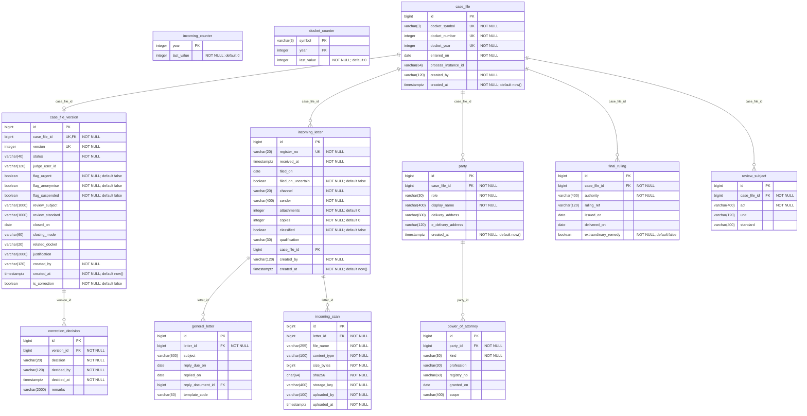
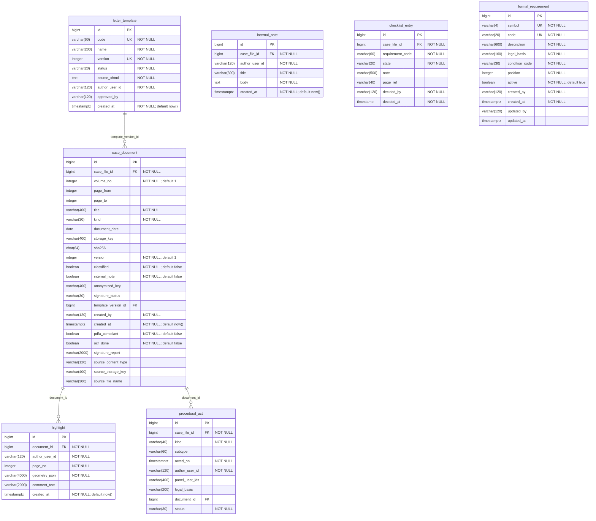
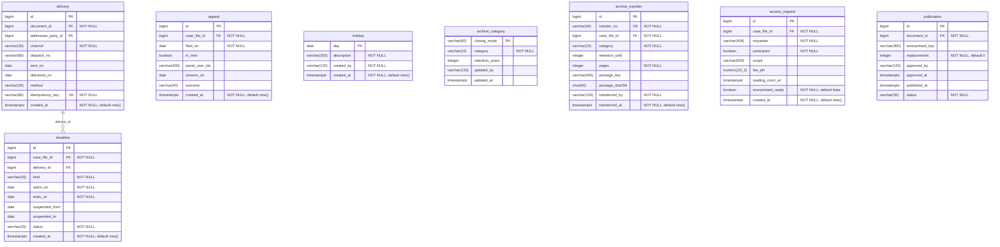

# Model fizyczny – diagram ERD (generowany: `infra/scripts/erd-fizyczny.py`)

Schemat `repertorium` w PostgreSQL po migracjach Flyway (`app/src/main/resources/db/migration`, uprawnienia roli aplikacji w `migration-postgresql`). 36 tabel, 26 kluczy obcych. Typy wg katalogu bazy (`timestamptz` = `timestamp with time zone`). Relacja `||--o|` to klucz obcy z ograniczeniem UNIQUE (1:1), `||--o{` – 1:N. Diagram przeglądowy pokazuje tylko klucze; diagramy grup – wszystkie kolumny.

## Przegląd (klucze i relacje)

```mermaid
erDiagram
  access_request {
    bigint id PK
    bigint case_file_id FK
  }
  app_user_seen {
    bigint id PK
    varchar(100) login UK
  }
  appeal {
    bigint id PK
    bigint case_file_id FK
  }
  archive_category {
    varchar(60) closing_mode PK
  }
  archive_transfer {
    bigint id PK
    varchar(30) transfer_no UK
    bigint case_file_id FK
  }
  audit_event {
    bigint id PK
  }
  authority {
    bigint id PK
    varchar(30) code UK
  }
  case_assignment {
    bigint id PK
    bigint case_file_id FK,UK
    varchar(120) user_id UK
    varchar(20) role UK
    date assigned_on UK
  }
  case_document {
    bigint id PK
    bigint case_file_id FK
    bigint template_version_id FK
  }
  case_file {
    bigint id PK
    varchar(3) docket_symbol UK
    integer docket_number UK
    integer docket_year UK
  }
  case_file_version {
    bigint id PK
    bigint case_file_id UK,FK
    integer version UK
  }
  checklist_entry {
    bigint id PK
    bigint case_file_id FK
  }
  correction_decision {
    bigint id PK
    bigint version_id FK
  }
  court {
    bigint id PK
    varchar(30) code UK
  }
  deadline {
    bigint id PK
    bigint case_file_id FK
    bigint delivery_id FK
  }
  delegation {
    bigint id PK
  }
  delivery {
    bigint id PK
    bigint document_id FK
    bigint addressee_party_id FK
    varchar(80) idempotency_key UK
  }
  docket_counter {
    varchar(3) symbol PK
    integer year PK
  }
  final_ruling {
    bigint id PK
    bigint case_file_id FK
  }
  formal_requirement {
    bigint id PK
    varchar(4) symbol UK
    varchar(20) code UK
  }
  general_letter {
    bigint id PK
    bigint letter_id FK
    bigint reply_document_id FK
  }
  highlight {
    bigint id PK
    bigint document_id FK
  }
  holiday {
    date day PK
  }
  incoming_counter {
    integer year PK
  }
  incoming_letter {
    bigint id PK
    varchar(20) register_no UK
    bigint case_file_id FK
  }
  incoming_scan {
    bigint id PK
    bigint letter_id FK
  }
  internal_note {
    bigint id PK
    bigint case_file_id FK
  }
  judge {
    bigint id PK
    varchar(100) user_id UK
  }
  letter_template {
    bigint id PK
    varchar(60) code UK
    integer version UK
  }
  letter_type {
    bigint id PK
    varchar(30) code UK
  }
  party {
    bigint id PK
    bigint case_file_id FK
  }
  power_of_attorney {
    bigint id PK
    bigint party_id FK
  }
  procedural_act {
    bigint id PK
    bigint case_file_id FK
    bigint document_id FK
  }
  publication {
    bigint id PK
    bigint document_id FK
  }
  review_standard {
    bigint id PK
    varchar(30) code UK
  }
  review_subject {
    bigint id PK
    bigint case_file_id FK
  }
  case_file ||--o{ access_request : "case_file_id"
  case_file ||--o{ appeal : "case_file_id"
  case_file ||--o{ archive_transfer : "case_file_id"
  case_file ||--o| case_assignment : "case_file_id"
  case_file ||--o{ case_document : "case_file_id"
  letter_template ||--o{ case_document : "template_version_id"
  case_file ||--o| case_file_version : "case_file_id"
  case_file ||--o{ checklist_entry : "case_file_id"
  case_file_version ||--o{ correction_decision : "version_id"
  case_file ||--o{ deadline : "case_file_id"
  delivery ||--o{ deadline : "delivery_id"
  party ||--o{ delivery : "addressee_party_id"
  case_document ||--o{ delivery : "document_id"
  case_file ||--o{ final_ruling : "case_file_id"
  incoming_letter ||--o{ general_letter : "letter_id"
  case_document ||--o{ general_letter : "reply_document_id"
  case_document ||--o{ highlight : "document_id"
  case_file ||--o{ incoming_letter : "case_file_id"
  incoming_letter ||--o{ incoming_scan : "letter_id"
  case_file ||--o{ internal_note : "case_file_id"
  case_file ||--o{ party : "case_file_id"
  party ||--o{ power_of_attorney : "party_id"
  case_file ||--o{ procedural_act : "case_file_id"
  case_document ||--o{ procedural_act : "document_id"
  case_document ||--o{ publication : "document_id"
  case_file ||--o{ review_subject : "case_file_id"
```

## Wpływ pism i repertorium

Tabele: `incoming_counter`, `incoming_letter`, `incoming_scan`, `general_letter`, `docket_counter`, `case_file`, `case_file_version`, `correction_decision`, `party`, `power_of_attorney`, `final_ruling`, `review_subject`

## Akta, czynności i podpisy

Tabele: `case_document`, `procedural_act`, `letter_template`, `highlight`, `internal_note`, `checklist_entry`, `formal_requirement`

## Doręczenia, terminy, zażalenia, archiwum

Tabele: `delivery`, `deadline`, `appeal`, `holiday`, `archive_category`, `archive_transfer`, `access_request`, `publication`

## Dostęp, osoby, słowniki, audyt

Tabele: `case_assignment`, `delegation`, `judge`, `app_user_seen`, `audit_event`, `court`, `authority`, `letter_type`, `review_standard`

```mermaid
erDiagram
  case_assignment {
    bigint id PK
    bigint case_file_id FK,UK "NOT NULL"
    varchar(120) user_id UK "NOT NULL"
    varchar(20) role UK "NOT NULL"
    date assigned_on UK "NOT NULL"
    date released_on
  }
  delegation {
    bigint id PK
    varchar(120) user_id "NOT NULL"
    varchar(60) function_code "NOT NULL"
    date valid_from "NOT NULL"
    date valid_to "NOT NULL"
    varchar(200) basis_doc_ref
    timestamptz revoked_at
    varchar(120) created_by "NOT NULL"
    timestamptz created_at "NOT NULL; default now()"
    varchar(300) basis_doc_key
    varchar(64) basis_doc_sha256
  }
  judge {
    bigint id PK
    varchar(100) user_id UK "NOT NULL"
    varchar(200) display_name "NOT NULL"
    varchar(20) function_code "NOT NULL"
    date term_from "NOT NULL"
    date term_to
    boolean active "NOT NULL; default true"
    varchar(120) created_by "NOT NULL"
    timestamptz created_at "NOT NULL"
    varchar(120) updated_by
    timestamptz updated_at
  }
  app_user_seen {
    bigint id PK
    varchar(100) login UK "NOT NULL"
    varchar(200) display_name
    varchar(400) roles "NOT NULL"
    timestamptz first_seen_at "NOT NULL"
    timestamptz last_login_at "NOT NULL"
    integer login_count "NOT NULL; default 1"
  }
  audit_event {
    bigint id PK
    timestamptz occurred_at "NOT NULL"
    varchar(120) user_id "NOT NULL"
    varchar(60) user_role
    varchar(80) action "NOT NULL"
    varchar(200) object_ref
    varchar(20) case_ref
    varchar(45) remote_addr
    char(64) prev_hash "NOT NULL"
    char(64) hash "NOT NULL"
  }
  court {
    bigint id PK
    varchar(30) code UK "NOT NULL"
    varchar(300) name "NOT NULL"
    boolean active "NOT NULL; default true"
  }
  authority {
    bigint id PK
    varchar(30) code UK "NOT NULL"
    varchar(300) name "NOT NULL"
    boolean active "NOT NULL; default true"
  }
  letter_type {
    bigint id PK
    varchar(30) code UK "NOT NULL"
    varchar(300) name "NOT NULL"
    boolean active "NOT NULL; default true"
  }
  review_standard {
    bigint id PK
    varchar(30) code UK "NOT NULL"
    varchar(200) provision "NOT NULL"
    varchar(400) description
    boolean active "NOT NULL; default true"
  }
```

## Tabele

| Tabela | Kolumny | Klucze obce (wychodzące) | Indeksy |
| --- | ---: | --- | ---: |
| `access_request` | 9 | case_file_id → case_file | 1 |
| `app_user_seen` | 7 | — | 2 |
| `appeal` | 8 | case_file_id → case_file | 1 |
| `archive_category` | 5 | — | 1 |
| `archive_transfer` | 10 | case_file_id → case_file | 2 |
| `audit_event` | 10 | — | 3 |
| `authority` | 4 | — | 2 |
| `case_assignment` | 6 | case_file_id → case_file | 3 |
| `case_document` | 24 | case_file_id → case_file, template_version_id → letter_template | 2 |
| `case_file` | 8 | — | 2 |
| `case_file_version` | 17 | case_file_id → case_file | 3 |
| `checklist_entry` | 8 | case_file_id → case_file | 2 |
| `correction_decision` | 6 | version_id → case_file_version | 2 |
| `court` | 4 | — | 2 |
| `deadline` | 10 | case_file_id → case_file, delivery_id → delivery | 2 |
| `delegation` | 11 | — | 2 |
| `delivery` | 10 | addressee_party_id → party, document_id → case_document | 2 |
| `docket_counter` | 3 | — | 1 |
| `final_ruling` | 7 | case_file_id → case_file | 1 |
| `formal_requirement` | 12 | — | 3 |
| `general_letter` | 7 | letter_id → incoming_letter, reply_document_id → case_document | 1 |
| `highlight` | 7 | document_id → case_document | 2 |
| `holiday` | 4 | — | 1 |
| `incoming_counter` | 2 | — | 1 |
| `incoming_letter` | 14 | case_file_id → case_file | 2 |
| `incoming_scan` | 9 | letter_id → incoming_letter | 2 |
| `internal_note` | 6 | case_file_id → case_file | 2 |
| `judge` | 11 | — | 3 |
| `letter_template` | 9 | — | 2 |
| `letter_type` | 4 | — | 2 |
| `party` | 7 | case_file_id → case_file | 1 |
| `power_of_attorney` | 7 | party_id → party | 1 |
| `procedural_act` | 10 | case_file_id → case_file, document_id → case_document | 1 |
| `publication` | 8 | document_id → case_document | 1 |
| `review_standard` | 5 | — | 2 |
| `review_subject` | 5 | case_file_id → case_file | 1 |
