# Model danych – diagram ER (generowany: `infra/scripts/er-diagram.py`)

Schemat `repertorium` (Flyway V1–V5). Wpisy repertorium są wersjonowane (`case_file_version`), korekty decydowane osobnym wierszem (`correction_decision`).

```mermaid
erDiagram
  access_request {
    bigint id PK
    string requester
    boolean participant
    string scope
    bigdecimal fee_pln
    instant reading_room_at
    boolean anonymised_ready
    instant created_at
    bigint case_file_id FK
  }
  appeal {
    bigint id PK
    localdate filed_on
    boolean in_time
    string panel_user_ids
    localdate session_on
    appealoutcome outcome
    instant created_at
    bigint case_file_id FK
  }
  archive_category {
    bigint id PK
    closingmode closing_mode
    string category
    integer retention_years
    string updated_by
    instant updated_at
  }
  archive_transfer {
    bigint id PK
    string transfer_no
    string category
    integer retention_until
    int pages
    string package_key
    string transferred_by
    instant transferred_at
    bigint case_file_id FK
  }
  audit_event {
    bigint id PK
    long id
    instant occurred_at
    string user_id
    string user_role
    string action
    string object_ref
    string case_ref
    string remote_addr
  }
  authority {
    bigint id PK
  }
  case_assignment {
    bigint id PK
    string user_id
    assignmentrole role
    localdate assigned_on
    localdate released_on
    bigint case_file_id FK
  }
  case_document {
    bigint id PK
    int volume_no
    integer page_from
    integer page_to
    string title
    documentkind kind
    localdate document_date
    string storage_key
    int version
    boolean classified
    boolean internal_note
    string anonymised_key
    signaturestatus signature_status
    boolean pdfa_compliant
    boolean ocr_done
    bigint case_file_id FK
    bigint template_version_id FK
  }
  case_file {
    bigint id PK
    string docket_symbol
    int docket_number
    int docket_year
    localdate entered_on
    string process_instance_id
    string created_by
    instant created_at
  }
  case_file_version {
    bigint id PK
    int version
    casestatus status
    string judge_user_id
    boolean flag_urgent
    boolean flag_anonymise
    boolean flag_suspended
    string review_subject
    string review_standard
    localdate closed_on
    closingmode closing_mode
    string related_docket
    string justification
    boolean is_correction
    string created_by
    bigint case_file_id FK
  }
  correction_decision {
    bigint id PK
    correctionstatus decision
    string decided_by
    instant decided_at
    string remarks
    bigint version_id FK
  }
  court {
    bigint id PK
  }
  deadline {
    bigint id PK
    deadlinetype kind
    localdate starts_on
    localdate ends_on
    localdate suspended_from
    localdate suspended_to
    deadlinestatus status
    instant created_at
    bigint case_file_id FK
    bigint delivery_id FK
  }
  delegation {
    bigint id PK
    string user_id
    string function_code
    localdate valid_from
    localdate valid_to
    string basis_doc_ref
    instant revoked_at
    string created_by
    instant created_at
  }
  delivery {
    bigint id PK
    deliverychannel channel
    string dispatch_no
    localdate sent_on
    localdate delivered_on
    deliverymethod method
    string idempotency_key
    instant created_at
    bigint document_id FK
    bigint addressee_party_id FK
  }
  docket_counter {
    bigint id PK
    string symbol
    int year
    int last_value
  }
  final_ruling {
    bigint id PK
    string authority
    string ruling_ref
    localdate issued_on
    localdate delivered_on
    boolean extraordinary_remedy
    bigint case_file_id FK
  }
  general_letter {
    bigint id PK
    string subject
    localdate reply_due_on
    localdate replied_on
    string template_code
    bigint letter_id FK
    bigint reply_document_id FK
  }
  highlight {
    bigint id PK
    string author_user_id
    int page_no
    string geometry_json
    string comment_text
    instant created_at
    bigint document_id FK
  }
  holiday {
    bigint id PK
    localdate day
    string description
    string created_by
    instant created_at
  }
  incoming_counter {
    bigint id PK
    int year
    int last_value
  }
  incoming_letter {
    bigint id PK
    string register_no
    instant received_at
    localdate filed_on
    boolean filed_on_uncertain
    intakechannel channel
    string sender
    int attachments
    int copies
    boolean classified
    letterqualification qualification
    string created_by
    instant created_at
    bigint case_file_id FK
  }
  internal_note {
    bigint id PK
    string author_user_id
    string title
    string body
    instant created_at
    bigint case_file_id FK
  }
  letter_template {
    bigint id PK
    string code
    string name
    int version
    templatestatus status
    string source_xhtml
    string author_user_id
    string approved_by
    instant created_at
  }
  letter_type {
    bigint id PK
  }
  party {
    bigint id PK
    partyrole role
    string display_name
    string delivery_address
    string e_delivery_address
    instant created_at
    bigint case_file_id FK
  }
  power_of_attorney {
    bigint id PK
    powerofattorneykind kind
    profession profession
    string registry_no
    localdate granted_on
    string scope
    bigint party_id FK
  }
  procedural_act {
    bigint id PK
    proceduralactkind kind
    string subtype
    instant acted_on
    string author_user_id
    string panel_user_ids
    string legal_basis
    actstatus status
    bigint case_file_id FK
    bigint document_id FK
  }
  publication {
    bigint id PK
    string anonymised_key
    int replacements
    string approved_by
    instant approved_at
    instant published_at
    publicationstatus status
    bigint document_id FK
  }
  review_standard {
    bigint id PK
    string code
    string provision
    string description
    boolean active
  }
  review_subject {
    bigint id PK
    string act
    string unit
    string standard
    bigint case_file_id FK
  }
  case_file ||--o{ access_request : "case_file_id"
  case_file ||--o{ appeal : "case_file_id"
  case_file ||--o{ archive_transfer : "case_file_id"
  case_file ||--o{ case_assignment : "case_file_id"
  case_file ||--o{ case_document : "case_file_id"
  letter_template ||--o{ case_document : "template_version_id"
  case_file ||--o{ case_file_version : "case_file_id"
  case_file_version ||--o{ correction_decision : "version_id"
  case_file ||--o{ deadline : "case_file_id"
  delivery ||--o{ deadline : "delivery_id"
  case_document ||--o{ delivery : "document_id"
  party ||--o{ delivery : "addressee_party_id"
  case_file ||--o{ final_ruling : "case_file_id"
  incoming_letter ||--o{ general_letter : "letter_id"
  case_document ||--o{ general_letter : "reply_document_id"
  case_document ||--o{ highlight : "document_id"
  case_file ||--o{ incoming_letter : "case_file_id"
  case_file ||--o{ internal_note : "case_file_id"
  case_file ||--o{ party : "case_file_id"
  party ||--o{ power_of_attorney : "party_id"
  case_file ||--o{ procedural_act : "case_file_id"
  case_document ||--o{ procedural_act : "document_id"
  case_document ||--o{ publication : "document_id"
  case_file ||--o{ review_subject : "case_file_id"
```

